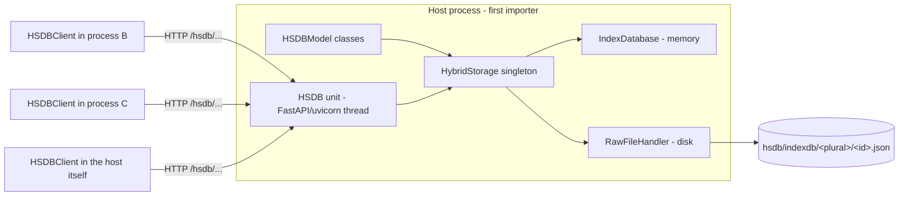

# HSDB - Hybrid Storage Database

An in-memory object database with a write-through raw-file store on disk, served over HTTP.
Models are plain Python classes; queries run against in-memory indices; the disk copy is a
JSON-file-per-entry mirror.

Status of this document: written from reading the code and running it (examples below were executed).
Statements marked **(verified)** were reproduced by running code, **(code)** come from reading it only.

---

## 1. Architecture



| Layer | File | Role |
|---|---|---|
| Models | `core/HSDBModel.py`, `HSDBAttribute.py`, `HSDBRelation.py`, `HSDBField.py`, `HSDBMeta.py` | Declarative schema, validation, serialization, ORM-ish classmethods |
| Query | `core/HSDBQuery.py` | Chainable query builder, also parses URL query strings |
| Memory | `IndexDatabase.py`, `indices/*` | Primary index + model index + field index + relational index |
| Disk | `RawFileHandler.py`, `RawFileStructure.py` | JSON file per entry under a fixed folder tree |
| Glue | `HybridStorage.py` | Singleton that applies every write to memory first, then disk |
| Serving (A) | `HSDBServer.py`, `django_support/*` | Django + DRF server with auto REST routes per model (standalone script style) |
| Serving (B) | `modulo/hsdb.py` (`HSDB` unit) + `HSDBClient.py` | Embedded FastAPI server in a background thread + name-based init-or-connect client (see section 6) |

Two serving paths exist and are independent: **(A)** `HSDBServer` is a blocking Django `runserver`
(`examples/student-db/student_db_server.py`), **(B)** the `HSDB` modulo unit is what you import from application code.
Both sit on the same `HybridStorage`.

---

## 2. The hybrid memory-disk store

### Write path (`HybridStorage.create_entry`)

1. `IndexDatabase.create_entry` builds the model instance (validation happens in `HSDBModel.__init__`),
   adds it to the primary index, the model index and all indexed-field indices.
2. If `write=True` and not cold mode, `RawFileHandler.create_entry` writes `<root>/hsdb/indexdb/<plural>/<id>.json`.
3. If the file does not exist afterwards, the memory entry is **rolled back** and `410` is returned.

`update_entry` / `delete_entry` apply to memory first, then disk. **Disk failures there are only logged**:
memory and disk can diverge silently.

Return codes used throughout: `200` ok, `404` not found, `409` already exists, `410` disk write lost, `500` error.

### Read path

Reads never touch disk. Everything is served from memory:

| Lookup | Cost | Mechanism |
|---|---|---|
| by id | O(1) | primary index (`Index`, dict keyed by id string) |
| all of a model | O(1) to get ids | `ModelIndex`: `{ModelName: {ids}}` |
| equality on an `indexed=True` attribute | O(1) | `FieldsIndex`: `{"Model.field": {value: {ids}}}` |
| anything else (`>`, `<`, `contains`, non-indexed `==`) | O(n) over the model's entries | linear filter |
| relation lookup | O(1) | `RelationalIndex` (forward + reverse dicts) |

Multiple indexed equality conditions are intersected. Remaining conditions are filtered linearly on the narrowed set.

### Cold mode

`cold_mode=True` skips creating the folder tree and all data/model-file writes: a pure in-memory database. Otherwise the folder is
`<root>/hsdb/<name>/` with root = `root_path` -> env `HSDB_ROOT_PATH` -> `/var/lib`. If it cannot be created the process **exits** (`err(exit=True)`).
The `hsdb` registry still writes its `server.lock`/`server.json` under that root in cold mode, so pass a writable `root_path`.

### Folder layout (`RawFileStructure._FS`, per database `<root>/hsdb/<name>/`)

`audits`, `backups/{indexdb,migration,rawfiles}`, `dumps/migrations`, `exports`, `indexdb`, `logs/{migrations,reads,writes}`,
`lut`, `models`, `rawfiles`, `redundancy`, `rejectpile/{indexdb,rawfiles}`, `reports`, plus `server.json` and `server.lock` (section 6).
Used today: `indexdb/<plural>/<id>.json` (entries) and `models/<Model>.json` (schema descriptors, written at host start). The rest is scaffolding.

### Restart behaviour: disk is write-only today

Nothing loads the files back at startup, and the manual path is broken **(verified)**:
`HybridStorage.install_index_files()` expects files shaped `{base_data, model_data, ...}` but
`RawFileHandler` writes the flat `Model.serialize()` dict, so it fails with `'NoneType' object has no attribute 'get'`.
A restarted host therefore starts empty even in non-cold mode.

---

## 3. Models

```python
class Student(HSDBModel):
    age        = HSDBAttribute(int, required=True, indexed=True)
    name       = HSDBAttribute(str, required=True, searchable=True)
    university = HSDBRelation.ManyToOne(University, required=True)
```

- Attribute types: `bool, dt, float, int, str`. Options: `required, indexed, unique, computed, editable, default, max_size, searchable, description`.
- Base attributes on every model: `id`, `created_at`, `updated_at` (all computed; passing them in `data` raises).
- Ids are generated at construction (`generate_id()`), **global across models** (not per model).
- Relations: `OneToOne`, `ManyToOne`, `ManyToMany` (`HSDBRelation.<Kind>(TargetModel)`). Stored as ids in the `RelationalIndex`,
  accepted as model instances, id strings, or id wrappers.
- Class metadata is derived on first instantiation: `model_name`, `resource_name(_plural)` (kebab case, `-model` suffix stripped), `path = <plural>/<id>.json`.
- Serialization: `Model.serialize(instance, include_relations=False, expand_relations=False)`.
  **Relations are omitted by default**; `include_relations` adds ids, `expand_relations` nests full objects (one level).
- Classmethods: `create, get, all, find_by, count, schema`; instance: `save, update, delete, validate`.
  They act on `HybridStorage.instance()` of *the current process*, so they only work in the host process.
- `unique=True` is **not enforced** on create (no check in `IndexDatabase.create_entry`) (code).

---

## 4. Querying

```python
Student.query.where('age').greater_than_or_equals(18).sort_by('name', 'desc').first()
```

Verbs: `equals, greater_than(_or_equals), less_than(_or_equals), contains`, aliases `eq/gt/gte/lt/lte`.
Terminals: `all, collect, first, last, count, get(id), paginate(page, size)`, plus iteration/`len`.
A query object is single-use (`already_executed`). `page=-1` means last page.

### URL form (`HSDBQuery.from_params`, used by both servers)

`?age__gte=18&gender=male&sort=-name&page=0&page_size=20&include_relations=true`

- Operators: `eq` (default), `gt`, `gte`, `lt`, `lte`, `contains`. `ne` and `in` are parsed but **silently ignored**.
- Values are coerced: `"18"` -> int, `"1.5"` -> float, `"true"/"false"` -> bool, `"null"/"none"` -> None.
  A *string* field whose value looks numeric (e.g. `"123"`) can therefore not be matched.
- `limit` only works together with `page`. `fields` and `ids_only` make the result non-model objects, which the
  serialization step cannot handle (the REST views and the HSDB unit do not support them).
- `HSDBQuery.to_query_string()` is the inverse and exists for building these URLs.

---

## 5. Quirks and gotchas

**Singleton / initialization**
- `HybridStorage` is a `SingletonMeta` singleton: the first construction wins, later `models`/`root_path`/`cold_mode` arguments are ignored.
- Anything that calls `HybridStorage()` bare (`HSDBQuery(...)`/`Model.query`, and instantiating any model that has relations) creates the
  default **non-cold** storage if none exists yet -> tries `/var/lib/hsdb` and may exit. In a client process never instantiate relation-bearing
  models or use `Model.query`; use `HSDBClient`.
- Import cycle: `core/` and `indices/` import `HybridStorage`/`IndexDatabase` from the package while `teatype/db/hsdb/__init__.py` is still
  executing, so `from teatype.db.hsdb import HybridStorage` yields the **module**, not the class (`'module' object is not callable`).
  Code in this cycle must import lazily from the submodule path (`from teatype.db.hsdb.HybridStorage import HybridStorage`).
- `HybridStorage` subclasses `Thread` but is never started; `coroutines/*.py` are empty; the queues are unused.

**Behaviour**
- Entry ids are global: `HybridStorage.fetch_entry(id)` does not check the model. The HSDB unit adds that check per route.
- Querying a completely empty database raises `KeyError('No db entries found')` (also `first()`/`last()`).
- Cold mode + `create_entry(write=True)` always yields `410` because no file is ever produced. Pass `write=False` in cold mode (the HSDB unit does).
- `HybridStorage.delete_entry` for an unknown id returns `500` (not `404`), because the lookup raises inside its `try`.
- `RawFileHandler.create_entry(model_instance, compress)` takes `compress` as 2nd parameter; `HybridStorage` passes `overwrite_path` there.
- `BaseIndex.__iter__` yields **values**, while `IndexDatabase.fetch_all()` and `print()` iterate it as if it yielded ids (code, not run).

**Modulo unit (`ApplicationUnit`) traps that the HSDB unit works around**
- `CoreUnit` forbids `Unit(...)`; use `Unit.create(**kwargs)` (keyword args only).
- `ApplicationUnit.__init__` installs SIGINT/SIGTERM handlers that call `shutdown()` and then **do not exit**, i.e. they swallow Ctrl+C for the whole host process; it also only works on the main thread. `HSDB` overrides `_setup_signal_handlers` to a no-op.
- The backend thread is non-daemon, so the host process would never exit. `HSDB` sets `backend.daemon = True`.
- Defaults start a Vite dashboard (`pnpm start`), Redis service, RAX and socket units. `HSDB` disables all of them.
- `teatype.modulo.hsdb` is both a submodule and (via `modulo/__init__.__getattr__`) a lazy attribute. If the submodule is imported first,
  `from teatype.modulo import hsdb` returns the module, not a client. Prefer `from teatype.modulo.hsdb import HSDB`.

---

## 6. Named databases: init-or-connect (`hsdb` registry + `HSDBClient`)

### Usage

Host script (the only one that needs the classes):

```python
from teatype.modulo.hsdb import hsdb

db = hsdb.init('school', models=[School, Student])      # non-cold, data in <HSDB_ROOT_PATH>/hsdb/school/
if db.server:                                            # True only in the hosting process
    db.create(School, {...})
```

Any other process, no classes needed:

```python
from teatype.modulo.hsdb import hsdb

db = hsdb['school']                                      # == hsdb.connect('school'), ConnectionError if nobody hosts it
db.Student.find(age=18)                                  # model proxy built from models/Student.json
```

A database is identified by its **name**, like a Postgres database; the port is chosen randomly and published, not configured.

1. `init()` takes an `flock` on `<db folder>/server.lock`. The lock holder is the host: it starts `HybridStorage` + FastAPI/uvicorn (daemon thread),
   writes `models/<Model>.json` for every model, waits until the server answers, then publishes `server.json` (`name, host, port, pid`).
2. If the lock is already held, `init()` connects instead (waiting up to `startup_timeout` for `server.json`), so simultaneous starts are race-free.
   The OS releases the lock when the host dies; the host also removes `server.json` on exit and a stale one is deleted by the next host.
3. `connect()`/`hsdb[name]` reads `server.json`, verifies via `GET /hsdb` that the answering service is HSDB **and** has that name,
   then loads `models/*.json` into `client.models`. Clients are cached per name in the process.
4. One process hosts at most one database (`HybridStorage` is a per-process singleton, `init()` of a second name raises) but can connect to many.
   Different names use different folders, ports and servers.

Root resolution is `root_path` -> env `HSDB_ROOT_PATH` -> `/var/lib`, identically for host and clients, so processes must agree on it
(the manual scripts set the env var). The lock is `fcntl`, i.e. POSIX only. The server dies with the **hosting process**.

### Schema-driven models (no classes in clients)

`models/<Model>.json` is `Model.schema()`: attributes (type, required, computed, indexed, unique, ...) and relations (kind, target model).
`client.Student` / `client.model('Student')` returns an `HSDBRemoteModel` with `fields`, `create`, `update`, `get`, `find`, `all`, `count`,
`delete`, `query()`. `create`/`update` validate client-side against the schema (unknown fields, missing required fields, int/str/float/bool types)
before any request is sent. Cold-mode databases publish no schema files, so only the string-name API works there.

### Client API (`HSDBClient`)

Models are given as class or name string. Results are **dicts**, not model instances (model constructors refuse computed fields like `id`).

```python
db.count('Student')
db.get('Student', id)                                  # dict or None
db.all('Student', expand_relations=True)
db.find('Student', gender='male', age__gte=18, sort='-name')
db.query('Student').where('age').greater_than_or_equals(18).sort_by('age', 'desc').first()   # same verbs as HSDBQuery (no gt/gte aliases)
db.create('Student', {...})                            # relations by id string
db.update('Student', id, {'age': 21})                  # PATCH, partial
db.delete('Student', id)                               # bool
db.info()                                              # {'service','name','pid','models':{name:count}}
```

`HSDBRemoteQuery` supports `where, equals, greater_than(_or_equals), less_than(_or_equals), contains, sort_by, paginate, all, first, last, count`
(`count()` fetches the list). Two conditions with the same field and operator overwrite each other.

### HTTP routes (all JSON, served by the unit)

| Method | Path | Purpose |
|---|---|---|
| GET | `/hsdb` | identity + per-model counts |
| GET | `/hsdb/{Model}` | query via `from_params` syntax |
| POST | `/hsdb/{Model}` | create |
| GET / PATCH / DELETE | `/hsdb/{Model}/{id}` | read / partial update / delete (404 if id missing or belongs to another model) |

`include_relations` / `expand_relations` are accepted on the GET and PATCH routes. The unit also keeps the generic `ApplicationUnit` routes
(`/status`, `/api/app/status`, `/api/logs`, ...). Handlers are plain `def`, so FastAPI runs them in its thread pool.

### Why HTTP and not Redis

Measured on loopback in this setup: `HSDBClient.get` by id **~0.95 ms** median, indexed `find` **~1.2 ms**, full-collection sorted
query (200 rows) **~4 ms** (keep-alive `requests.Session`). A bare Redis `PING` is ~0.04 ms, but a request/response over Redis would
additionally need a worker thread, a reply channel and serialization in the host, and a running Redis daemon; the repo's Redis layer is pub/sub
message dispatch, not RPC. The achievable gain is a fraction of a millisecond per call while adding an infrastructure dependency, so HTTP was
chosen (also: works across machines, debuggable with curl, reuses `from_params`). If per-call latency ever matters, batch with `find` instead
of many `get` calls, or add a Redis list-based RPC behind the same `HSDBClient` interface.

### Security

The server has no authentication and exposes create/update/delete. It binds to `127.0.0.1` by default; do not expose it on other interfaces
without adding auth. Model names from URLs are looked up in the registered-model dict (no dynamic import/eval).

---

## 7. Examples and manual test scripts

`py/tests/integration/hsdb/manual/` (data lands in the gitignored `teatype/dist/hsdb/school/`), run in this order from that folder:

```bash
python 01_host.py          # defines models, hsdb.init('school', ...), seeds, keeps running until Enter
python 02_client_read.py   # hsdb['school'], reads via schema-built models, no model classes
python 03_client_write.py  # create/update/delete + client-side validation, checks the files on disk
```

Re-running `01_host.py` seeds again and adds new files next to the old ones (ids are new each run; nothing is reloaded, see section 2).

`examples/student-db/student_db_hsdb.py` is the same pattern with cold mode (run it twice: host, then client).
`examples/student-db/student_db_server.py` is the standalone Django (`HSDBServer`) variant with auto REST routes per model.

---

## 8. Fixes made while building the unit

These were pre-existing breakages that blocked creating/serving entries:

- `HybridStorage.__init__`: `IndexDatabase` resolved to the module (import cycle) -> lazy import.
- `HSDBRelation.__init__`, `HSDBQuery.__init__`: same cycle for `HybridStorage` -> lazy import.
- `RawFileHandler` / `parse_index_files`: used `fs.index`, folder was renamed to `indexdb` -> `fs.indexdb`.
- `HybridStorage.create_entry`: `model_instance.serialize()` (classmethod without instance) -> `model_instance.model.serialize(model_instance)`.
- `HSDBModel.__setattr__`: relations given as plain id strings (the JSON case) crashed on `.instance` -> wrapped into a field.
- `HSDBModel.serialize`: imported `HSDBRelation` from the package (not exported) -> removed, it is already imported at module top.
- `django_support/views.py`: imported `HSDBQuery` from the package root -> from `core`.
- `modulo/__init__.py`: lazy `hsdb` accessor imported a non-existent `teatype.db.hsdb.HSDB`.
- `HSDBClient.py` was a stub that instantiated a unit at import time; replaced by the HTTP client.

## 9. Open items (not changed)

- Restore from disk on startup (format mismatch, see section 2).
- Enforce `unique=True`; `ne`/`in` operators; `ids_only`/`fields` serialization.
- Relation resolution only fully implemented for many-to-one in `HSDBRelation._RelationWrapper` (see TODOs in `HSDBModel.py`).
- Detached host process (models passed by import path) instead of "dies with the launching process".
